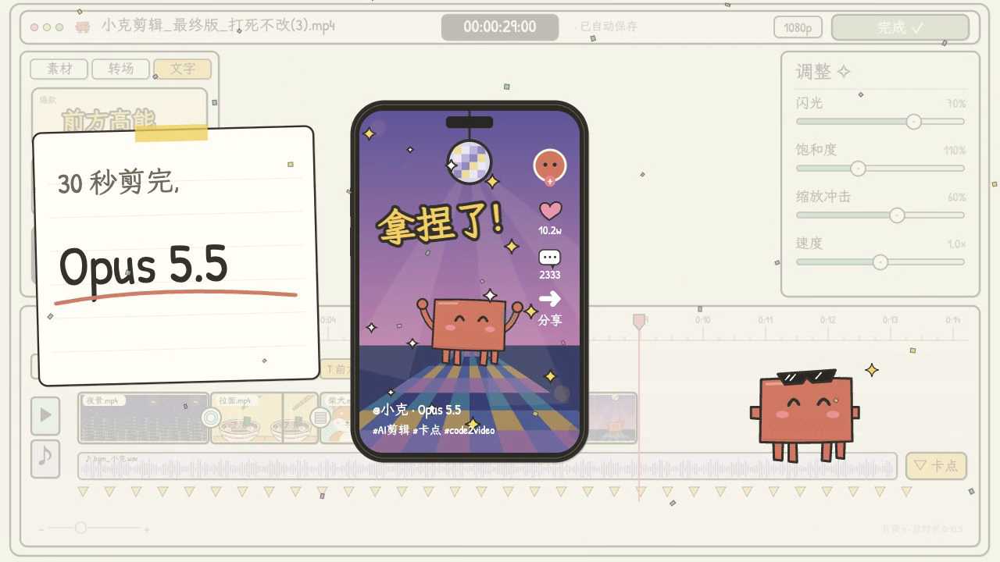

# Claude video editor motion — Remotion recreation

A 30-second hand-drawn animation of a tiny orange character editing a video: dragging clips, cutting ramen footage, adding transitions and captions, undoing a typo, adjusting color, adding beat markers and exporting to a social video.



## Run and render

Requires Node.js 20+ and npm. The self-test also needs `ffmpeg` and `ffprobe` on PATH.

```sh
npm ci
npm start
npm run render
npm run still
npm run selftest
```

The Studio opens a browser editor. The full render writes `out/claude-video-motion.mp4`. The composition is **ClaudeVideoMotion**, **1280×720**, **30 fps**, **900 frames / 30 seconds**. Remotion downloads its supported Chrome Headless Shell on first render; no media or fonts require network access once installed. To use an existing Chrome installation instead, set `REMOTION_BROWSER_EXECUTABLE` to its executable path.

## Editable source

- `src/Art.tsx`: SVG mascot, night skyline, ramen, shiba and disco illustrations.
- `src/Editor.tsx`: editor panels, preview, tracks, controls and character actions.
- `src/Video.tsx`: camera keyframes, introduction, finale and synchronized audio.
- `src/Root.tsx`: composition dimensions and duration.
- `public/fonts/`: bundled OFL handwriting fonts and licenses.
- `docs/REFERENCE-ANALYSIS.md`: palette, layout, timing and known fidelity limits.

The visuals are React/SVG components, with deterministic time-based movement. There is no embedded reference video or screenshot slideshow. All fonts and runtime media are included. The stereo reference audio has been extracted for timing fidelity; the original MP4 is kept only in a local ignored directory.

## Verification

`npm run selftest` scans for credentials, runs TypeScript, formatting and eight mocked binding API contract tests, renders the complete movie, extracts 12 story frames, verifies video/audio metadata, and renders frame 510 twice to confirm deterministic output. Results are retained in `evidence/`; full render logs and MP4 are in ignored `out/`.

```sh
node scripts/verify-publication.mjs OWNER/REPOSITORY
```

The publication check verifies public visibility, matching local/remote HEAD, and required remote files. Its report is in `out/publication.json` because a report containing its own commit hash cannot be committed without changing that hash.

The recording-specific binding helper reads its credential from **stdin**, never from code or command-line arguments:

```sh
node scripts/bind-repository.mjs https://github.com/OWNER/REPOSITORY < /path/to/private-token-file
```

A 409 stops without changing existing bindings; a 401 requires refreshing the credential from the source page. Successful responses must contain the exact recording ID and repository URL. Only those safe fields and the HTTP status are saved.

## Reference and attribution

[Motionface reference recording](https://motionface.cc/?recording=e3ee409a-50f7-4b4a-af27-288226e47a57), reference title: “claude\_剪视频过程motion”.

This recreation approximates the original drawing geometry, handwriting and motion curves. Reference illustrations and audio remain the property of their respective owners; no license to those materials is asserted by this repository. Font licenses are included separately. Remotion has its own [license terms](https://www.remotion.dev/docs/license).

Signed video addresses and binding credentials are intentionally absent from Git. `.reference/`, `.private/`, `.env*` and rendered video output are ignored.
